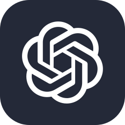
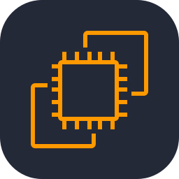
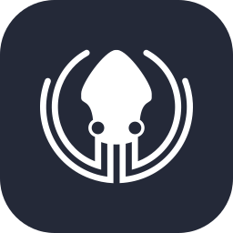

**사람이 할 일**과 **에이전트에게 맡길 일**을 나누는 데 관심이 많습니다. 
아낀 시간은 **더 중요한 판단**에 씁니다.

 

 

## 소개

- **CSLEE**에서 개발하고 있습니다.
- 집 노트북을 홈서버 **gawon-dev**로 꾸려 포트폴리오와 블로그를 직접 운영하고 있습니다.
- **Claude Code**, **Codex** 같은 AI 에이전트와 함께 개발하고 있습니다.
- 학습 기록은 [`*-notes` 레포](https://github.com/wongakim-99?tab=repositories&q=notes)에 차곡차곡 쌓고 있습니다.

 

## 기술 스택

<table>
  <tr>
    <td align="center" width="140"><b>언어</b></td>
    <td>
      
      
      
      
    </td>
  </tr>
  <tr>
    <td align="center"><b>백엔드</b></td>
    <td>
      
      
      
    </td>
  </tr>
  <tr>
    <td align="center"><b>AI API</b></td>
    <td>
      
    </td>
  </tr>
  <tr>
    <td align="center"><b>데이터베이스</b></td>
    <td>
      
      
      
    </td>
  </tr>
  <tr>
    <td align="center"><b>인프라 · 데브옵스</b></td>
    <td>
      
      
      
      
    </td>
  </tr>
  <tr>
    <td align="center"><b>협업</b></td>
    <td>
      
      
      
      
    </td>
  </tr>
  <tr>
    <td align="center"><b>개발 도구</b></td>
    <td>
      
      
      
      
      
    </td>
  </tr>
  <tr>
    <td align="center"><b>운영체제</b></td>
    <td>
      
      
    </td>
  </tr>
</table>

 

## 프로젝트

| 프로젝트 | 소개 | 기술 |
| :-- | :-- | :-- |
| [**portfolio**](https://github.com/wongakim-99/portfolio) | 홈서버에서 직접 운영하는 소개 · 포트폴리오 · 블로그 사이트 | `Next.js` `NestJS` `MongoDB` |
| [**똑똑**](https://github.com/SMU-TtokTtok/backend) | 상명대학교 리크루팅 서비스 | `Java` `Spring Boot` |
| [**이로운**](https://github.com/CCT-BEST-OF-BEST/beneficial-be) | 충청톤 · AI 기반 초등 돌봄반 한국어 교육 플랫폼 | `FastAPI` `RAG` |
| [**Pawpong**](https://github.com/Pawpong/pawpong_backend) | 믿을 수 있는 반려동물 브리더와 입양자 연결 서비스 | `NestJS` `MongoDB` |

 

## 활동

<picture>
  <source media="(prefers-color-scheme: dark)" srcset="https://raw.githubusercontent.com/wongakim-99/wongakim-99/output/snake-dark.svg" />
  <source media="(prefers-color-scheme: light)" srcset="https://raw.githubusercontent.com/wongakim-99/wongakim-99/output/snake.svg" />
  
</picture>

 

  

